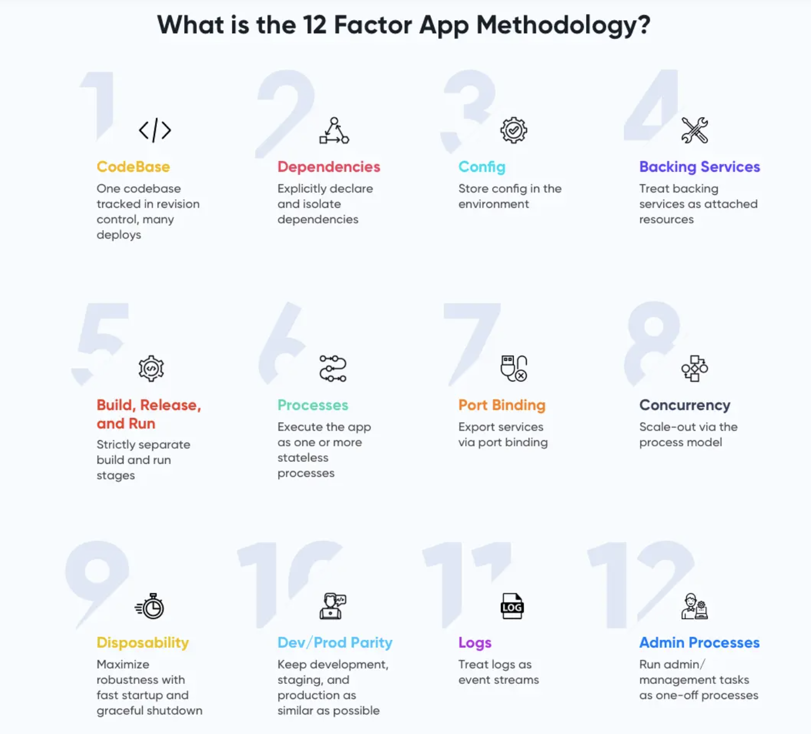

<h1>
  The 12 Factor App Methodology for Saas
  What is The 12 Factor App Methodology?
</h1>

**Learning objective:** By the end of this lesson, learners will be able to describe the purpose of the 12-Factor App methodology and explain its benefits for building scalable and cloud-ready applications.

 

 

## The 12 Factor App

The **Twelve-Factor App Methodology** is a set of best practices for building software-as-a-service or **SaaS** applications. It was developed by the team at [Heroku](https://devcenter.heroku.com/) in 2012.

It defines a set of rules (known as the 12 Factor App Principles) that emphasize:

- _Declarative setup for easy onboarding of new developers._

- _Portability across environments by maintaining a clean separation from the underlying operating system._

- _Compatibility with modern cloud platforms, eliminating the need for server management._

- _Reducing differences between development and production to support continuous deployment._

- _Scalability without major changes to architecture or tooling._

This approach applies to any programming language and integrates with various backing services like databases, queues, or memory caches.

## Why was it created?

The 12 principles raise awareness of systemic problems in modern app development, provide a shared vocabulary for discussing these challenges, and offer broad conceptual solutions inspired by works like Martin Fowler's Patterns of Enterprise Application Architecture.

## Why would we use these rules?

Following the 12-Factor App Methodology helps you build scalable, secure, and cloud-ready applications.

By adhering to these principles, you:

- Use tools that meet cloud-based requirements, minimizing environment-specific bugs.

- Ensure that your app can easily scale up or down based on demand, reducing infrastructure costs.

- Keep credentials and sensitive data out of code repositories, storing them in the app's environment for better security.

- Enforce a clean separation of duties, making your app easier to manage and more resilient over time.
